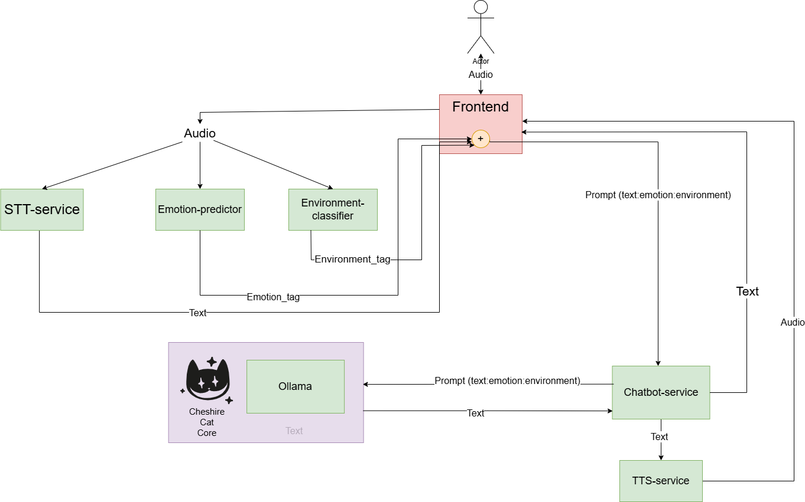

Ecco come aggiungere il passaggio per l'attivazione del plugin Emotional Agent nel README.md:

# Emotive-chatbot

Sistema conversazionale multimodale basato su AI con riconoscimento emotivo e ambientale.
emotion-speaker-chatbot
- Architettura a Microservizi (Python/Docker):
   Progettazione e sviluppo di un'architettura distribuita e scalabile interamente in Python (FastAPI). Il sistema è strutturato in 8 microservizi indipendenti, containerizzati con Docker Compose e orchestrati tramite un API Gateway (NGINX) per la gestione delle richieste REST asincrone. 
- Integrazione LLM e Framework Conversazionale: 
   Implementazione del core conversazionale sfruttando LLaMA 3.2B (tramite Ollama) e il framework Cheshire Cat. Sviluppo di plugin custom in Python per iniettare dinamicamente nel prompt le informazioni sul contesto emotivo e ambientale, generando risposte altamente empatiche. 
- Sviluppo Modelli di Deep Learning (CNN): 
   Addestramento from scratch di una Rete Neurale Convoluzionale (CNN) personalizzata in Python per l'Emotion Recognition. Il modello elabora spettrogrammi Mel estratti dall'audio (dataset CREMA-D) per classificare le emozioni vocali dell'utente. 
- Speech-to-Text & Text-to-Speech: 
   Integrazione di modelli open-source di ultima generazione in microservizi dedicati: Whisper (OpenAI) per la trascrizione vocale robusta e ChatTTS per la sintesi vocale dinamica, capace di adattare parametri prosodici (tono, ritmo) in base all'emozione rilevata. 
- Classificazione Ambientale: 
   Integrazione del modello preaddestrato YAMNet per l'analisi acustica del contesto ambientale dell'utente (es. stanza chiusa, strada), arricchendo ulteriormente il contesto fornito all'LLM. 
- Full-Stack Development: 
   Realizzazione di un'interfaccia frontend responsiva in HTML5, CSS3 e JavaScript Vanilla, integrata con FastAPI e Jinja2, capace di gestire l'acquisizione audio asincrona e riprodurre dinamicamente testo e voce generati dall'AI.

# Guida alla Configurazione di Cheshire Cat Core

## Prima Configurazione

Quando si avvia Cheshire Cat Core per la prima volta, è necessario configurare manualmente l'integrazione con Ollama seguendo questi passaggi:

1. Aprire il browser e andare all'indirizzo: [http://localhost:1865/admin](http://localhost:1865/admin)

2. Effettuare l'accesso con le seguenti credenziali predefinite:
   - **Username**: `admin`
   - **Password**: `admin`

3. Nel pannello di amministrazione, navigare su **Settings → Large Language Model → Configure**

4. Inserire i seguenti parametri:
   - **Service**: `Ollama`
   - **Base URL**: `http://host.docker.internal:11434`
   - **Model**: `llama3.2:3b`

5. Cliccare sul pulsante **Save** per applicare la configurazione

6. Attivare il plugin Emotional Agent andando su **Plugins → Emotional Agent plugin** e imposta lo switch su **on**

## Note Importanti

- Il modello `llama3.2:3b` viene scaricato automaticamente all'avvio del container Ollama grazie al servizio `init-ollama`
- La prima esecuzione potrebbe richiedere più tempo per completare il download del modello
- Le configurazioni dei servizi sono gestite tramite variabili d'ambiente nel file `.env`
- I modelli scaricati vengono salvati nel volume persistente `./ollama-models`
- Il plugin Emotional Agent permette al chatbot di adattare le risposte in base alle emozioni rilevate nell'utente
- Se dovessero verificare problemi di comunicazione tra i vari microservizi **riavviare container api-gateway**

Dopo aver completato questa configurazione, il sistema sarà pronto all'uso con l'integrazione tra Cheshire Cat Core e Ollama correttamente impostata.

## Architettura del sistema
L'architettura del sistema è la seguente:

